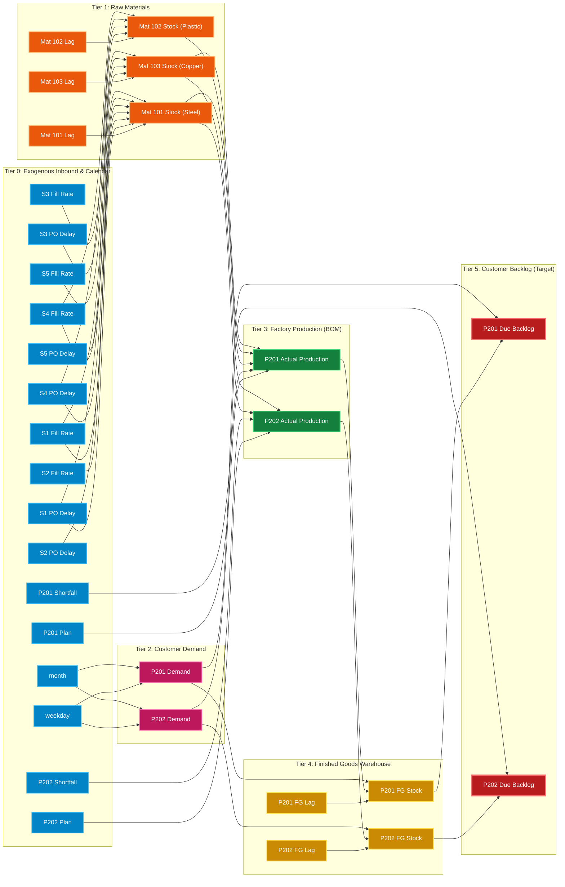

# Project SAGE — Expert Causal Graph (DAG)

> **Research Framing**:
> *"SAGE performs controlled synthetic causal-attribution evaluation under an expert-defined causal model; it does not claim to prove real-world causality."*

---

## 🧭 How to View This Graph in VS Code

You have **3 convenient ways** to view this graph directly inside VS Code:

### Option 1: Native Markdown Preview (Quickest & Crisp Vector)
1. Open this file ([`CAUSAL_GRAPH.md`](file:///Users/asl/Desktop/sage-starter/CAUSAL_GRAPH.md)) in VS Code.
2. Press **`Cmd + Shift + V`** (or **`Cmd + K V`** for side-by-side preview).
   *(On Windows/Linux: `Ctrl + Shift + V` or `Ctrl + K V`)*
3. VS Code renders the **Mermaid diagram below automatically** as a high-resolution flowchart.

### Option 2: Image Preview in Editor Tab
1. In the VS Code File Explorer (left sidebar), click:  
   👉 [`analytics/causal_graph.png`](file:///Users/asl/Desktop/sage-starter/analytics/causal_graph.png) *(or [`causal_graph.svg`](file:///Users/asl/Desktop/sage-starter/analytics/causal_graph.svg))*
2. VS Code will open the 300-DPI color-coded architectural diagram directly in an editor tab.

### Option 3: Interactive Visualizer (Pan, Zoom, Click-to-Inspect)
1. Open [`analytics/causal_graph.html`](file:///Users/asl/Desktop/sage-starter/analytics/causal_graph.html).
2. Right-click and choose **"Open with Live Server"** or open in your browser, or:
3. In VS Code, press **`Cmd + Shift + P`** &rarr; Type **`Simple Browser: Show`** &rarr; Enter:  
   `file:///Users/asl/Desktop/sage-starter/analytics/causal_graph.html`
4. Click any node to see its parents, children, and operational description in the sidebar!

---

## 📊 Live Mermaid Diagram (VS Code Renderable)

---

## 📋 Graph Architecture Specifications

- **Total Nodes**: 32 operational variables
- **Total Directed Edges**: 40 physical mechanisms
- **Graph Storage**: Serialized in [`stage7/fitted_causal_model.pkl`](file:///Users/asl/Desktop/sage-starter/stage7/fitted_causal_model.pkl)
- **Code Definition**: [`stage7/build_causal_model.py`](file:///Users/asl/Desktop/sage-starter/stage7/build_causal_model.py)
