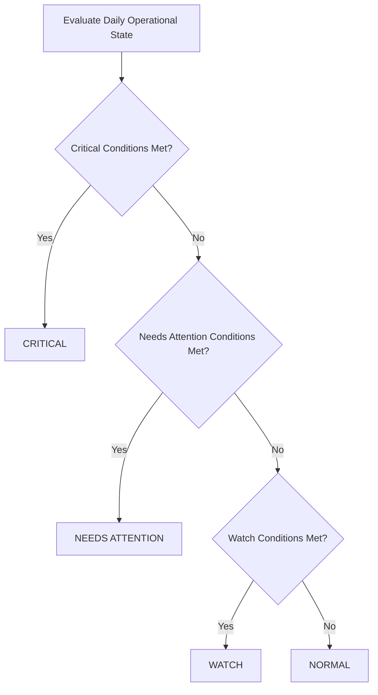

# SAGE Report Parameters & Operational Decision Rules

> **Mandatory Scientific Framing:**
> *"SAGE performs controlled synthetic causal-attribution evaluation under an expert-defined causal model; it does not claim to prove real-world causality."*

This document provides a comprehensive, ground-truth inventory of every parameter, rule, weight, threshold, and statistical baseline governing SAGE daily reports. Every value is pre-registered and version-controlled to eliminate post-hoc tuning.

---

## 1. Alert Selection & Action Prioritization

Implemented in [`stage9/priorities.py`](file:///Users/asl/Desktop/sage-starter/stage9/priorities.py) and configured in [`stage9/config/rules.yaml`](file:///Users/asl/Desktop/sage-starter/stage9/config/rules.yaml).

Candidate actions are generated deterministically from live ERP state and sorted by a strict hierarchy:
$$\text{Sort Key} = (\text{Rule Number ASC},\; -\text{Days Overdue},\; -\text{Severity Weight})$$

The top 5 candidates form the day's priority action list. If fewer than 5 candidate actions exist, forward-looking calm-day fillers populate remaining slots.

| Parameter / Rule | Source File & Line | Default Value | Operational Meaning | Baseline / Seasonality |
| :--- | :--- | :--- | :--- | :--- |
| **Rule 1: Overdue Customer Orders** | `stage9/priorities.py:98-154` | Rule 1 (Top rank) Weight: $10.0 + (2.0 \times \text{days\_overdue})$ | Prioritizes already overdue sales orders by days overdue DESC, then pending units DESC. Role: Planner. | None (pure ERP state $\le$ `as_of`). |
| **Rule 2: At-Risk Customer Orders** | `stage9/priorities.py:156-205` `stage9/config/rules.yaml:33` | Rule 2 Horizon: 3 days Weight: $5.0 + \text{pending\_units}$ | Detects sales orders due within 1–3 business days where projected finished goods inventory is insufficient. Role: Planner. | None (deterministic projection). |
| **Rule 3: Raw Material Depletion** | `stage9/priorities.py:206-234` | Rule 3 Weight: $15.0 + (\text{safety} - \text{stock})$ | Triggers when material stock $\le$ safety stock, or stock $\le$ reorder point with 0 open replenishment POs. Role: Procurement. | Static threshold. |
| **Rule 4: Overdue Purchase Orders** | `stage9/priorities.py:236-252` | Rule 4 Weight: $10.0 + (2.0 \times \text{days\_overdue})$ | Identifies open supplier POs past expected delivery date. Ranked by days overdue DESC. Role: Procurement. | None (contractual delivery date). |
| **Rule 5: Production Shortfall** | `stage9/priorities.py:254-269` | Rule 5 Weight: $5.0 + \text{shortfall\_units}$ | Flags products where actual production on `as_of` was less than planned build. Role: Plant Manager. | None (daily shift plan). |
| **Order at Risk Horizon** | `stage9/config/rules.yaml:33` | `3` business days | Look-ahead horizon for evaluating order delivery risk. | Static parameter. |
| **Calm-Day Fillers** | `stage9/priorities.py:285-390` | Top 5 fill rules | If Rules 1–5 yield $<5$ items: (1) orders due in next 3 days, (2) next PO arrivals, (3) lowest days-of-cover materials. If none exist: "Nothing needs action tomorrow." | None (strictly data-grounded). |

---

## 2. Root-Cause Tracing & Causal Model Check

Implemented in [`stage9/trace.py`](file:///Users/asl/Desktop/sage-starter/stage9/trace.py) and configured in [`stage9/config/rules.yaml`](file:///Users/asl/Desktop/sage-starter/stage9/config/rules.yaml:85-102).

Operates over a trailing 7-day operational window across the frozen Expert Causal DAG (32 nodes, 40 directed edges).

| Parameter / Rule | Source File & Line | Default Value | Operational Meaning | Baseline / Seasonality |
| :--- | :--- | :--- | :--- | :--- |
| **Trailing Window** | `stage9/config/rules.yaml:90` `stage9/trace.py:309` | `7` days | Temporal search window (`as_of - 6 days` to `as_of`) for upstream causal propagation. | Rolling trailing calendar window. |
| **Modified Z-Score Threshold** | `stage9/config/rules.yaml:87` `stage9/trace.py:246, 265` | `3.5` | Abnormality cutoff: $Z = 0.6745 \times \frac{\|x - \text{median}\|}{\text{MAD}} \ge 3.5$. | **Weekday Baseline**: Computed per weekday across 365 days of 2025 panel (`analytics/daily_panel_baseline.parquet`). |
| **Modified Z Multiplier** | `stage9/config/rules.yaml:88` `stage9/trace.py:259` | `0.6745` | Scaling factor consistency multiplier for median absolute deviation (MAD). | Fixed mathematical constant. |
| **Zero-Inflated Percentile** | `stage9/config/rules.yaml:89` `stage9/trace.py:269` | `99.0` (p99) | Fallback abnormality threshold when $\text{MAD} = 0$ (e.g., supplier delay days, shortfalls). | Global empirical 99th percentile across 2025 baseline. |
| **Material Stock Outlier Rule** | `stage9/trace.py:262-264` | $Z \le -3.5$ or $\text{stock} \le \text{safety}$ | For raw materials, abnormality is one-sided downward depletion. | Fixed safety stock floor. |
| **Active Sourcing Graph Filter** | `stage9/trace.py:113-170` | Derived dynamically | Dynamically prunes DAG supplier-material edges to only suppliers with at least one historical PO $\le$ `as_of`. | Empirical transaction history. |
| **Temporal Ordering Guard** | `stage9/trace.py:442-448` | $t_{\text{upstream}} \le t_{\text{downstream}}$ | Upstream parent node must become abnormal on or before downstream symptom. | Strict chronological sequence. |
| **Confidence: "Seen end to end"** | `stage9/trace.py:451-452` | Root $\in$ Exogenous AND Length $\ge 3$ | Unbroken chain of abnormal nodes from root exogenous event (delay/shortfall) to customer symptom. | Multi-hop structural path. |
| **Confidence: "Partly seen"** | `stage9/trace.py:453-454` | Root $\in$ Exogenous OR Length $\ge 2$ | Direct 2-node link or exogenous event directly connected without intermediate stage observed. | Two-node structural link. |
| **Confidence: "No upstream explanation"**| `stage9/trace.py:455-456` | Length $= 1$ | Symptom observed without abnormal ancestor in trailing 7 days. | Unattributed symptom. |
| **Max Reported Chains** | `stage9/config/rules.yaml:91` `stage9/trace.py:295` | `3` chains | Maximum cause chains returned for the daily briefing. | Ranked by confidence, length, deviation. |
| **Model Check Threshold** | `stage9/trace.py:533-546` `web/templates/method.html:117` | $S_{p95} = 0.218006$ | Method 1 attribution score must clear pre-registered 95th percentile null threshold. | Calibrated against synthetic null simulations. |

---

## 3. Narrative Generation & Quality Guards

Implemented in [`stage9/narrate.py`](file:///Users/asl/Desktop/sage-starter/stage9/narrate.py) and [`web/one_page_data.py`](file:///Users/asl/Desktop/sage-starter/web/one_page_data.py).

Governed by a strict contract where LLM acts only as a phrasing engine, never an authority on facts, priorities, or severity.

| Parameter / Rule | Source File & Line | Default Value | Operational Meaning | Baseline / Seasonality |
| :--- | :--- | :--- | :--- | :--- |
| **System Prompt Persona** | `stage9/narrate.py:45-50` | Plant-operations writer | Instructs model to rewrite ONLY supplied facts into short plain sentences; prohibits adding numbers, causes, or advice. | Fixed prompt template. |
| **Bottom Line Length** | `stage9/narrate.py:20` | Max 2 sentences, $\le 50$ words | Executive takeaway displayed at the top of the daily report. | Enforced by regex validator. |
| **Daily Summary Length** | `web/one_page_data.py:260-310` | 6–7 lines, 90–120 words | Standardized executive briefing paragraph for daily operations. | Enforced by sentence synthesis & length check. |
| **Forbidden Tokens Scan** | `stage9/narrate.py:19` `stage8/common.py:FORBIDDEN_TOKENS` | 0 forbidden tokens | Strictly rejects technical artifacts (`INC_`, `null`, `NaN`, `traceback`, SQL, paths). | Static token blocklist. |
| **Fact-Grounding Validator** | `stage9/narrate.py:71-120` | Exact set containment | Asserts that every number, supplier name, material name, and product name exists in the snapshot facts. | Exact match against ERP snapshot. |
| **Deterministic Fallback** | `stage9/narrate.py:220-270` | Rule-based template | If LLM generation fails validators after 2 retries, a deterministic rule-based template is emitted. | Deterministic fallback guarantee. |
| **Framing Invariant** | Verbatim Rule 2 | Verbatim sentence | Must appear on every rendered page, email, PDF, and audit report. | Mandatory scientific governance. |

---

## 4. Plant Banner Tier Assignment & Severity Scoring

Implemented in [`stage9/snapshot.py:420-437`](file:///Users/asl/Desktop/sage-starter/stage9/snapshot.py#L420-L437) and pre-registered in [`stage9/config/rules.yaml:37-71`](file:///Users/asl/Desktop/sage-starter/stage9/config/rules.yaml#L37-L71).

The plant banner tier follows a strict evaluation precedence: $\text{CRITICAL} \succ \text{NEEDS\_ATTENTION} \succ \text{WATCH} \succ \text{NORMAL}$.

### Pre-Registered Tier Conditions

| Tier | Precedence | Trigger Conditions (OR) | Operational Rationale |
| :--- | :---: | :--- | :--- |
| **CRITICAL** | 1 | 1. Any raw material stock $\le 0.0$ (stockout) 2. Any raw material stock $\le$ safety stock **AND** an overdue PO exists 3. Overdue customer backlog units actively rising vs yesterday **AND** traced cause exists (overdue PO or production shortfall) | Physical production halted or actively worsening customer delivery default. |
| **NEEDS ATTENTION** | 2 | 1. Standing overdue customer backlog exists (steady, not rising) 2. An overdue purchase order exists (`days_overdue > 0`) 3. Production below plan today (`production_shortfall > 0`) | Ongoing operational friction requiring supervisor intervention, but not worsening. |
| **WATCH** | 3 | 1. Elevated customer demand intake ($\ge 10$ units on product) 2. Partial goods receipt delivered today ($\text{fill\_rate} < 1.0$) | Early warning indicator that could deplete safety buffers. |
| **NORMAL** | 4 | None of the above conditions met. | All inventory above safety stock, production on track, zero backlog. |

### Composite Plant Severity Score

In addition to categorical tiers, SAGE computes a continuous severity score:
$$\text{Score} = (\text{Backlog Units} \times 10.0) + (\text{Overdue Orders} \times 5.0) + (\text{Material Stockouts} \times 25.0) + (\text{Production Shortfall} \times 2.0) + (\text{PO Overdue Days} \times 4.0)$$

| Severity Component | Weight | Source File & Line | Unit of Measure |
| :--- | :---: | :--- | :--- |
| `due_backlog_per_unit` | **10.0** | `stage9/config/rules.yaml:66` | Points per unfulfilled overdue customer unit |
| `order_overdue_per_day` | **5.0** | `stage9/config/rules.yaml:67` | Points per overdue customer order count |
| `material_stockout` | **25.0** | `stage9/config/rules.yaml:68` | Points per raw material at or below safety stock |
| `production_shortfall_per_unit` | **2.0** | `stage9/config/rules.yaml:69` | Points per unbuilt unit vs planned schedule |
| `po_overdue_per_day` | **4.0** | `stage9/config/rules.yaml:70` | Points per cumulative day supplier POs are overdue |

---

## 5. Stock, Capacity & Supplier Thresholds

Pre-registered in [`stage9/config/rules.yaml`](file:///Users/asl/Desktop/sage-starter/stage9/config/rules.yaml:5-30, 78-83).

### Raw Material Inventory Parameters

| Material ID | Material Name | Safety Stock | Reorder Point | Standard Lead Time | Primary Active Supplier |
| :---: | :--- | :---: | :---: | :---: | :--- |
| **101** | Steel Rod 10mm | 50.0 kg | 150.0 kg | 5 days | EastCoast Components (Supplier 4) |
| **102** | Plastic Granules | 40.0 kg | 120.0 kg | 4 days | Global Polymers Co (Supplier 3) |
| **103** | Copper Wire | 30.0 kg | 100.0 kg | 6 days | Copper & Co (Supplier 5) |

### Finished Goods Inventory & Capacity Parameters

| Product ID | Product Name | Safety Stock | Reorder Point | Nominal Daily Capacity | BOM Requirements |
| :---: | :--- | :---: | :---: | :---: | :--- |
| **201** | Widget Model X | 15.0 units | 30.0 units | 30.0 units / day | 2 kg Steel, 1 kg Plastic, 0.5 kg Copper |
| **202** | Widget Model Y | 10.0 units | 25.0 units | 20.0 units / day | 1.5 kg Steel, 0 kg Plastic, 1.0 kg Copper |

### Days-of-Cover Risk Windows

- **Critical Horizon:** $\le 3.0$ days of cover (material exhaustion imminent within lead time).
- **Warning Horizon:** $\le 7.0$ days of cover (material requires review if replenishment not in transit).

### Supplier Performance Rating Rules (Insights Tab)

- **Grade A:** On-time delivery rate $\ge 90.0\%$ **AND** Quantity fill rate $\ge 95.0\%$.
- **Grade B:** On-time delivery rate $\ge 70.0\%$ (or fill rate $\ge 85.0\%$).
- **Grade C:** On-time delivery rate $< 70.0\%$.
- **Insufficient Sample:** Delivery count $< 5$ orders triggers *"Too few deliveries to rate"* disclaimer.
